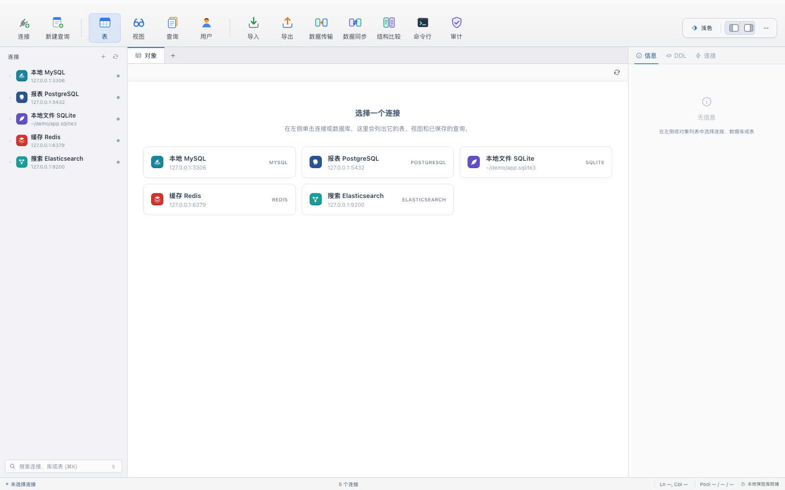

# LuxBase

[简体中文](README.md) | **English**

A database client I built for myself and use every day — Navicat-style, but free and open source.
Written with Tauri 2 + Rust + React/Monaco, it handles **MySQL, PostgreSQL, SQLite, Redis and Elasticsearch**, and ships a small MCP server so AI assistants can query your databases too (without ever seeing your passwords).



## Why I built it

Navicat is nice, but it's pricey — and I was constantly jumping between it, a Redis GUI and an ES console.
So I wrote one tool that does all of it: query, edit, export, transfer and sync, in a single window.
It's been my daily driver for a while now, and maybe it's useful to you too.

## Things it does well

- **A proper SQL workbench**: the Monaco editor (the same one VS Code uses), multiple tabs, filters with mixed AND/OR groups, one-click CSV / JSONL export, resizable columns everywhere.
- **Edit data without writing UPDATEs**: double-click a result cell and type. Change as many rows and columns as you like, then apply everything in **one transaction — any failure rolls it all back**. BLOBs get HEX/text previews and editing too.
- **Full-featured Redis**: browse keys per DB, binary-safe keys and values (UTF-8 / GBK / hex / base64), an embedded command console, and no freezing on huge keyspaces.
- **Real Elasticsearch management**: indices, mappings, aliases, document editing, Query DSL and a REST console.
- **Big-table transfers that don't hurt**: keyset pagination + batched transactional commits, with live progress, rate and ETA. Optionally drop secondary indexes first and recreate them afterwards — a lifesaver on very large tables.
- **Security taken seriously**: credentials sealed with AES-256-GCM on your machine, never uploaded. Dangerous operations need confirmation, and everything lands in an append-only audit log.
- **Connections travel with you**: batch import/export in a passphrase-sealed envelope.

## Let your AI assistant query your databases (MCP)

The bundle includes `luxbase-mcp`, a local MCP server.
Once configured, AI assistants like Claude or Qoder can query the connections you've saved in LuxBase — **your passwords stay inside the local vault and are never shared with the AI**.

```json
{
  "mcpServers": {
    "luxbase": {
      "command": "/Applications/LuxBase.app/Contents/MacOS/luxbase-mcp",
      "args": []
    }
  }
}
```

It's read-only by default (table metadata, single-statement SELECTs, Redis scans, ES searches). Set `args` to `["--allow-writes"]` to also expose an `execute` tool for single write statements.
Every statement an agent runs is appended to the LuxBase audit log.

## Install (macOS, Apple Silicon)

1. Download `LuxBase_<version>_aarch64.dmg` and drag LuxBase.app into Applications.
2. If macOS says the developer can't be verified: right-click → Open, or run
   `xattr -dr com.apple.quarantine /Applications/LuxBase.app`.
   (The bundle is ad-hoc signed, not notarized — build from source if you prefer.)
3. Create a connection and you're in. Everything lives locally under `~/Library/Application Support/com.luxbase.app/`.

A bilingual (Chinese/English) install guide is included in the DMG.

## Build from source

You'll need Rust (stable) and Node.js 20+:

```bash
npm install
npm run validate                      # static checks and audit gates
node scripts/build-macos-app.js --dmg # build the app and DMG (includes luxbase-mcp)
```

Run the tests:

```bash
cd src-tauri && cargo test --lib
```

There's also a live suite that only runs against **throwaway servers you explicitly point it at**, using `luxbase_qa_`-prefixed tables:

```bash
LUXBASE_LIVE_MYSQL="127.0.0.1|3306|user|password|testdb" cargo test --lib
LUXBASE_LIVE_POSTGRES="127.0.0.1|5432|user|password|testdb" cargo test --lib
LUXBASE_LIVE_REDIS="127.0.0.1|6379|password" cargo test --lib
```

## Honest limitations

- No custom CA / mTLS settings for Redis yet, and very large values can be previewed and copied but not fully edited.
- The big-table optimizations are benchmarked at the 100k-row scale; I haven't had a real 100M-row database to push it against — tell me how it goes if you do.
- Only macOS Apple Silicon packages are published. Windows/Linux should be possible with Tauri, I just haven't had the time to verify.

Found a bug or missing something? Open an issue — I read them.

## License

[MIT](LICENSE) © 2026 charl. Use it however you like; PRs are welcome.
