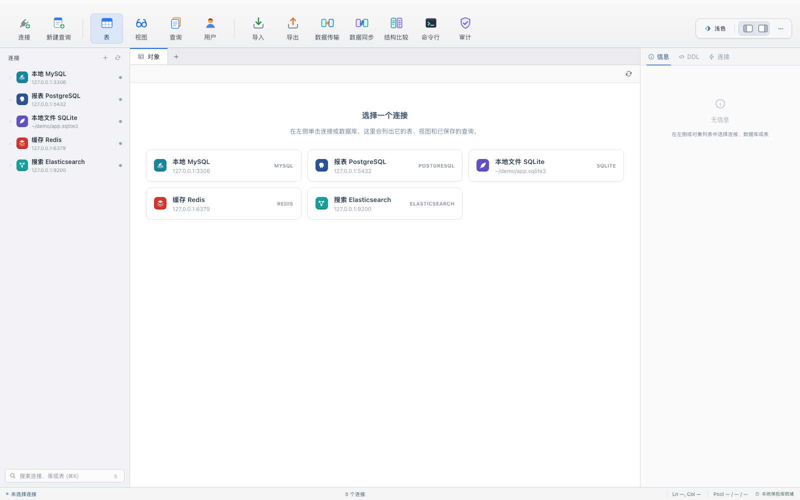

<div align="center">


# LuxBase

**The free, open-source Navicat alternative.**
One window for MySQL · PostgreSQL · SQLite · Redis · Elasticsearch · Milvus · Qdrant — with a built-in MCP server for AI agents.

[](LICENSE)
[](https://github.com/char518/LuxBase/releases)
[](#install-macos)
[](https://tauri.app)

**English** | [简体中文](README.zh-CN.md)



</div>

LuxBase is a database client I built for myself and use every day. It started because Navicat is great but pricey, and I kept juggling it with a Redis GUI and an ES console. So I wrote one tool that does all of it — query, edit, export, transfer, sync — in a single window. It's been my daily driver for a while now; maybe it's useful to you too.

## LuxBase vs Navicat

| What you do in Navicat | In LuxBase |
| --- | --- |
| Connect to MySQL / PostgreSQL / SQLite | Same, plus Redis, Elasticsearch, Milvus and Qdrant |
| Browse, filter and edit table data | Double-click to edit cells; batch changes commit in one transaction with full rollback |
| SQL queries, history, execution plans | Monaco editor + query history + execution plans |
| Export results | CSV / JSON Lines, filenames include table and timestamp |
| Data transfer / sync / structure compare | All included; keyset pagination + batched commits with live rate and ETA |
| Manage and migrate connections | Batch import/export in a passphrase-sealed envelope |
| Price | Free, GPL-3.0 open source |

**On top of that**: unified Redis/ES management, Milvus & Qdrant vector stores, an MCP server so AI agents can query your databases, and fully open code you can change yourself.

## Protocol coverage

| | MySQL | PostgreSQL | SQLite | Redis | Elasticsearch | Milvus | Qdrant |
| --- | :-: | :-: | :-: | :-: | :-: | :-: | :-: |
| Browse & edit data | ✓ | ✓ | ✓ | ✓ | ✓ | ✓ | ✓ |
| Query console | SQL | SQL | SQL | Raw commands | Query DSL / REST | Vector / REST | Vector / REST |
| Transfer & sync | ✓ | ✓ | ✓ | — | — | — | — |
| Structure compare | ✓ | ✓ | ✓ | — | — | — | — |

## Highlights

- **A proper SQL workbench** — the Monaco editor (the same one VS Code uses), multiple tabs, filters with mixed AND/OR groups, one-click CSV / JSONL export, resizable columns everywhere.
- **Edit data without writing UPDATEs** — double-click a result cell and type. Stage changes across as many rows and columns as you like, then apply everything in **one transaction; any failure rolls it all back**. BLOBs get HEX/text previews and editing too.
- **Full-featured Redis** — browse keys per DB, binary-safe keys and values (UTF-8 / GBK / hex / base64), type-aware value editing, an embedded command console, and no freezing on huge keyspaces.
- **Real Elasticsearch management** — indices, mappings, aliases, document CRUD, Query DSL and a REST console.
- **Vector databases too** — Milvus (and Zilliz Cloud) and Qdrant: browse collections, inspect schema and indexes, run vector similarity search and scalar queries, edit entities/points, and a raw REST console. Dangerous drops and deletes need confirmation and land in the audit log.
- **Big-table transfers that don't hurt** — keyset pagination + batched transactional commits with live progress, rate and ETA. Optionally drop secondary indexes first and rebuild them afterwards; a lifesaver on very large tables.
- **Security taken seriously** — credentials sealed with AES-256-GCM on your machine, never uploaded. Dangerous operations need confirmation, and everything lands in an append-only audit log.
- **Connections travel with you** — batch import/export in a passphrase-sealed envelope, so moving machines is painless.

## AI agent access (MCP)

The bundle includes `luxbase-mcp`, a local stdio MCP server. Once configured, AI assistants like Claude or Qoder can query the connections you've saved in LuxBase — **your passwords stay inside the local vault and are never shared with the AI**.

```json
{
  "mcpServers": {
    "luxbase": {
      "command": "/Applications/LuxBase.app/Contents/MacOS/luxbase-mcp",
      "args": []
    }
  }
}
```

Read-only by default: table metadata, single-statement SELECTs (100 rows default, 1000 max), Redis scans, ES searches, and vector similarity search on Milvus/Qdrant. Set `"args": ["--allow-writes"]` to also expose an `execute` tool for single write statements. Every statement an agent runs is appended to the LuxBase audit log.

## Install (macOS)

1. Download the DMG for your Mac from [Releases](https://github.com/char518/LuxBase/releases), then drag LuxBase.app into Applications:
   - **Apple Silicon (M1/M2/M3/M4)**: `LuxBase_2.3.0_aarch64.dmg`
   - **Intel**: `LuxBase_2.3.0_x64.dmg`
2. The bundle is ad-hoc signed, not notarized. If macOS says the developer can't be verified: right-click → Open, or run
   ```bash
   xattr -dr com.apple.quarantine /Applications/LuxBase.app
   ```
   Prefer full control? [Build from source](#build-from-source) instead.
3. Create a connection and you're in. Everything lives locally under `~/Library/Application Support/com.luxbase.app/`.

A bilingual (English/Chinese) install guide is included in the DMG.

## Build from source

Requires Rust (stable) and Node.js 20+:

```bash
npm install
npm run validate                      # static checks and audit gates
node scripts/build-macos-app.js --dmg # build the app and DMG (includes luxbase-mcp)
```

Run the tests:

```bash
cd src-tauri && cargo test --lib
```

A live suite also exists, and it only runs against **throwaway servers you explicitly point it at**, using `luxbase_qa_`-prefixed tables:

```bash
LUXBASE_LIVE_MYSQL="127.0.0.1|3306|user|password|testdb" cargo test --lib
LUXBASE_LIVE_POSTGRES="127.0.0.1|5432|user|password|testdb" cargo test --lib
LUXBASE_LIVE_REDIS="127.0.0.1|6379|password" cargo test --lib
```

## Honest limitations

- No custom CA / mTLS settings for Redis yet; very large values can be previewed and copied but not fully edited.
- Big-table optimizations are benchmarked at the 100k-row scale. I haven't had a real 100M-row database to push against — tell me how it goes if you do.
- macOS only for now, with separate Intel and Apple Silicon builds. Windows/Linux should be possible with Tauri; I just haven't had the time to verify.

## Contributing

Found a bug or missing something? [Open an issue](https://github.com/char518/LuxBase/issues) — I read them. Pull requests are welcome too.

## License

[GPL-3.0](LICENSE) © 2026 charl. Use it freely, with one rule: derivative works must also be open-sourced under GPL-3.0 — no closed-source forks. The LuxBase name and logo are not covered by the license; use your own branding for derivatives.